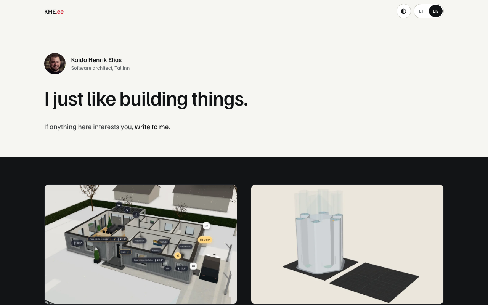

# khe-sites

[](https://github.com/khelias/khe-sites/actions/workflows/ci.yml)
[](https://github.com/khelias/khe-sites/actions/workflows/deploy.yml)
[](https://github.com/khelias/khe-sites/actions/workflows/codeql.yml)

Static source for the public KHE web presence, [khe.ee](https://khe.ee) and
[games.khe.ee](https://games.khe.ee), in plain HTML, CSS and JavaScript, for
anyone curious how one family's sites and homelab fit together.

[](https://khe.ee/en/)

## How it works

- [khe.ee](https://khe.ee) - the landing page and the pages about how it is
  made: the [home server](https://khe.ee/architecture/) (the estate in one
  diagram, how a change reaches it from a push, how it stays up and where it
  is weak), its [decisions](https://khe.ee/architecture/decisions/) (the ones
  that shape it most, the register and every estate decision on its own page) and
  [agentic development](https://khe.ee/agents/) (the steps a planned change
  takes, and what the agents' checks found)
- [khe.ee/ha](https://khe.ee/ha/) - the Home Assistant 3D house view on a
  made-up house, built from
  [khe-home-assistant](https://github.com/khelias/khe-home-assistant)
- [khe.ee/workshop](https://khe.ee/workshop/) - Töökoda, the household's
  printable parts, built from
  [khe-workshop](https://github.com/khelias/khe-workshop)
- [games.khe.ee](https://games.khe.ee) - the launcher that links into the
  game apps, which deploy from their own repos

The architecture pages are built from their public sources, the decisions
and estate index in [khe-architecture](https://github.com/khelias/khe-architecture)
and the stacks in [khe-homelab](https://github.com/khelias/khe-homelab), so
they follow them without anyone copying text across. Analytics are
Cloudflare Web Analytics, loaded only after the visitor consents.

## Run it

```sh
npm ci
npm run check
```

The build reads `khe-architecture`, `khe-homelab`, `khe-home-assistant` and
`khe-workshop` checked out next to this repo, or the paths in their
environment variables, and needs `python3` for the 3D house and Töökoda
builds. The rules for working on the code are in [AGENTS.md](AGENTS.md).

## Where it runs

Every push to `main` deploys both sites to the homelab, which serves them
behind Cloudflare; an hourly copy at the Cloudflare edge answers when the
homelab does not.

## More

- [DESIGN.md](DESIGN.md) - the family look every KHE page shares
- [docs/decisions/](docs/decisions/) - this repo's own decisions
- [AGENTS.md](AGENTS.md) - layout, commands and rules for working on the code

## Licence

MIT, see [LICENSE](LICENSE).
